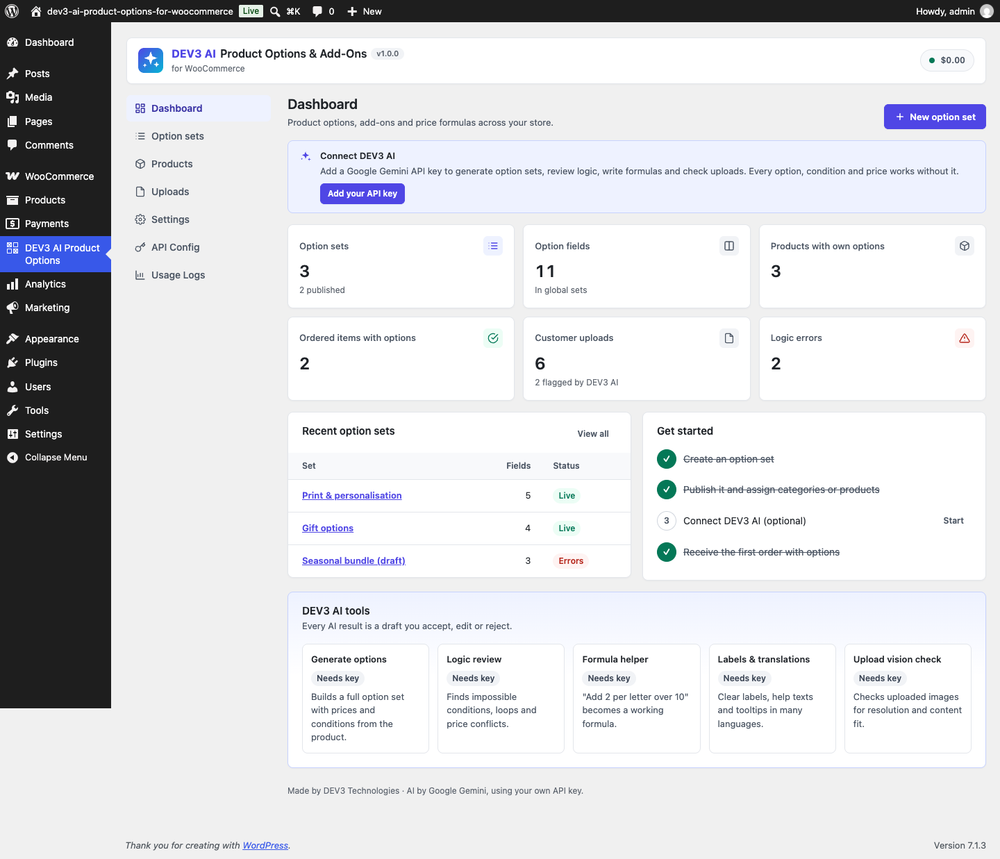

# DEV3 AI Product Options & Add-Ons for WooCommerce

Extra product options with 25 field types, conditional logic, steps, repeaters, price formulas and global option sets, plus DEV3 AI that builds and checks them for you.



## Features

Add personalisation, upgrades and extras to any WooCommerce product: engraving text priced per letter, colour and image swatches, file uploads, dates, measurements with a price formula, gift options and more. Prices update live on the product page and flow through the cart, checkout (classic and block), orders, emails and the admin.

### Core features
* 25 field types: text, textarea, email, URL, phone, number, range slider, dropdown, radio buttons, checkbox group, colour swatches, image swatches, image picker, single checkbox, toggle, date, time, date & time, file upload, colour picker, hidden value, repeater, section, step, paragraph.
* Conditional logic: show or hide any field, section or step when all/any rules match (is, is not, contains, empty, greater than, checked…).
* Sections, multi-step wizards and repeaters (e.g. one name and number per team player).
* Price types: flat, percent of the product price, per character (with free characters), per unit, quantity tiers and formulas such as `max(0, {len} - 10) * 2` or `{width} * {height} * 0.002`. Charge per item or once per cart line.
* Global option sets assigned by category (incl. sub-categories), tag or product, with priorities and exclusions; per-product fields, "own fields only" mode, set exclusion and per-product price overrides.
* Live price box, client and server validation (server is always authoritative).
* Cart, checkout, order, email and admin display; edit options from the cart; "order again" keeps options.
* File uploads with type, size and minimum-resolution rules, stored in a protected folder and linked from the order.
* Block cart & checkout and HPOS compatible; Gutenberg block, shortcode `[dev3po_product_options id="123"]`, Elementor widget and WPBakery element.
* Translations per field (WPML, Polylang, TranslatePress or site language), RTL stylesheets, translation-ready.
* Import/export option sets as JSON.

### DEV3 AI features (Google AI, your own key)
* Generate options: DEV3 AI reads the product title and description and drafts the complete option set (fields, choices, prices, conditions) as structured JSON, validated against a schema.
* Logic checker: finds impossible conditions, circular dependencies and price conflicts before you publish (works without AI), plus an AI review for subtler problems.
* Formula helper: "add 2 per letter over 10 letters" becomes `max(0, {len} - 10) * 2`, validated and shown with worked examples.
* Labels, help texts, tooltips and translations into many languages.
* Upload vision check: DEV3 AI checks uploaded images for content fit and quality and tells the shopper how to fix it (warn or block).

Every AI result is a draft you accept, edit or reject. Nothing is saved without your click. The plugin is fully usable with AI turned off or without a key.

### Privacy
AI features send only the data they need (product title/description, field labels, or an uploaded image for the vision check) to Google AI using your API key. The key stays on your server. Customer uploads can be exported and erased with the WordPress personal-data tools.

## Requirements

- WordPress 6.0 or newer (tested up to 6.8)
- PHP 7.4 or newer
- WooCommerce 8.0 or newer (required)
- Optional: your own Google AI API key (from Google AI Studio) to switch on the DEV3 AI features. The rest of the plugin works without one.

## Installation

### From the release zip

1. Download `dev3-ai-product-options-for-woocommerce.zip` from the [latest release](https://github.com/dev3tech/dev3-ai-product-options-for-woocommerce/releases/latest).
2. In WordPress, go to **Plugins → Add New → Upload Plugin**, choose the zip and click **Install Now**.
3. Click **Activate**.

### Build from source

```bash
git clone https://github.com/dev3tech/dev3-ai-product-options-for-woocommerce.git
cd dev3-ai-product-options-for-woocommerce
composer install --no-dev
npm ci
npm run build
```

Then copy the `dev3-ai-product-options-for-woocommerce` folder into `wp-content/plugins/` and activate it.

### Getting started

1. Upload the plugin zip in Plugins › Add New › Upload, then activate it (WooCommerce must be active).
2. Open "DEV3 AI Product Options" in the admin menu.
3. Create an option set or open a product and use the "DEV3 AI Options" tab.
4. Optional: add a Google AI API key in API Config to turn on DEV3 AI.

## FAQ

### Does it work without an API key?
Yes. Every field, condition, price type, upload and cart feature works without AI.

### Does it work with the block cart and checkout?
Yes. Options appear in the block cart and checkout and prices are applied through the Store API.

### Can shoppers change options after adding to cart?
Yes. The product link in the cart opens the product with the chosen options; saving replaces the cart line.

### Where are uploaded files stored?
In wp-content/uploads/dev3po-uploads/ with random names and direct access denied (Apache). Files never ordered are deleted after the retention period (default 14 days). On Nginx, add a deny rule for that folder.

## Documentation

The full HTML guide (installation, settings, hooks and FAQ) is in [`docs/index.html`](docs/index.html). Open it in a browser after cloning or downloading the repository.

## Changelog

### 1.0.1
* Branding: the upload vision check now says "DEV3 AI looks at each uploaded image".

### 1.0.0
* Initial release.

## Licence

Released under the GNU General Public License v2.0 or later (GPL-2.0-or-later). See [LICENSE](LICENSE).

## More from DEV3

- [DEV3 AI Product Options & Add-Ons for WooCommerce on the DEV3 Marketplace](https://www.dev3.tech/item/dev3-ai-product-options-for-woocommerce)
- [More WordPress plugins, themes and templates from DEV3](https://www.dev3.tech/marketplace)
